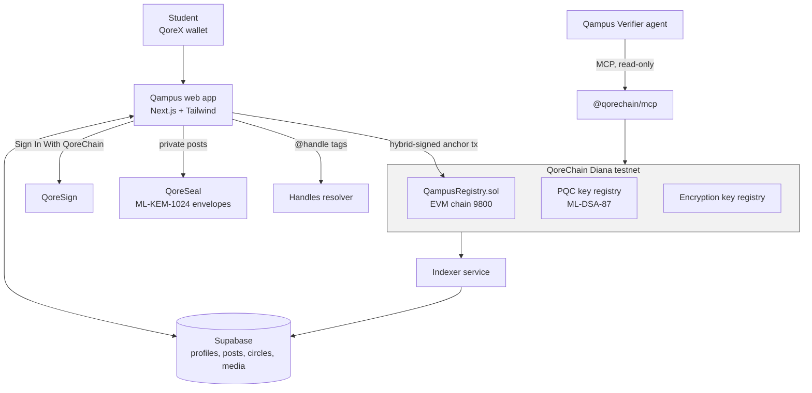

# Qampus Proposal

Nov 19, 2026 · @obijohnbosco163 · QoreChain “Build Before Q-Day” Developer Fest (build.qorechain.io)

# Project Title

**Qampus** (pronounced “campus”, the Q is for QoreChain) is a social platform built only for campus students. Students post the milestones that define their school years (SIWES training, what they built, project defences, internal and external defence reports, photos, videos and demos), label every friend by their real campus role (course rep, level mate, dev bro, tech sis, departmental president and more), tag them in posts, and can then **anchor** any milestone on QoreChain so it becomes a tamper-proof, post-quantum-signed record that supervisors and employers can verify.

**Tagline:** Your campus story, proven. Share it. Label it. Anchor it.

Name rationale: short, memorable, easy to say in any Nigerian campus, “Q” ties it to QoreChain and post-quantum security, and it works as a domain, handle and logo (a Q whose tail is a graduation-cap tassel).

# Team Information

| **Name**               | **Responsibility**                                                                                              |
|------------------------|-----------------------------------------------------------------------------------------------------------------|
| Obi Johnbosco Chinonso | Proposal, tech stack, architecture, smart contract, frontend, backend, UI/UX, pitch and demo video (solo build) |

**Team Name:** Qampus

**Team Lead Contact:** obijohnbosco163@gmail.com · 09132246153

**Assumption:** solo team (1 member). Post-Quantum dApp allows 1 to 3 members, so a solo entry is valid. Because every member must be a current student for the Quantum Campus award, the builder is a student at the Federal University of Technology Owerri (FUTO). Update this table if teammates join.

# Problem Statement

- **What is the problem?** A student’s best work is scattered and unprovable. SIWES experience lives in a logbook, the final-year project in a PDF on a phone, the defence in a WhatsApp group, and the story of who helped, who supervised and who built with whom is never recorded. General social apps (WhatsApp, Instagram, X) are not made for this: they do not understand a course rep from a classmate, cannot prove a report is genuine, and bury milestones in the noise.

- **Who experiences this problem?** Undergraduates and graduates of Nigerian and African universities, polytechnics and colleges, especially in tech and engineering where there is real work to show: SIWES placements, hackathons, final-year projects and defences. Supervisors, course reps, student unions and early employers experience it from the other side: they cannot easily confirm what a student claims.

- **Why is it important to address?** Fake or unverifiable certificates and reports erode trust in genuine students. Juniors have nowhere to see how seniors actually passed their defence or what a good SIWES report looks like. Without a verifiable record, the work of a talented student from a lesser-known school is easy to ignore.

- **What are the existing limitations?** LinkedIn is professional but cold and not campus-shaped. Social apps have no concept of academic roles or milestones. Any “proof” today is a PDF that can be edited. And any proof signed with classical cryptography alone will be forgeable once large quantum computers arrive, which matters for records meant to last decades (“Q-Day”).

# Target Audience

- **Primary: campus students** aged 18 and above (100 level to alumni), starting with FUTO and spreading to other Nigerian universities. Highest value for 300 to 500 level students in SIWES and final-year project phases.

- **Secondary: verifiers and mentors:** project supervisors, SIWES industry supervisors, departmental and faculty leaders, student unions and tech communities, who endorse milestones.

- **Tertiary: employers and hackathon organizers** who open a student’s public Passport page to check verified work.

It is relevant because it keeps the fun of a campus social network (friends, labels, tagging) and adds something no other app gives students: proof.

# Proposed Solution and Approach

Qampus has four layers so each stays simple:

- **The Social Layer:** feed, profiles, Circles (relationship labels), @tagging, reactions and comments, organised around campus life.

- **The Milestone Layer:** structured posts for SIWES, projects, defences and experiences, each with media, documents and a chosen visibility.

- **The Trust Layer:** a student can **anchor** a milestone: the app hashes the content and writes the hash, type and timestamp to the QampusRegistry contract with a hybrid (secp256k1 + ML-DSA-87) signed transaction. A supervisor can **endorse** it with their own signed attestation. Anyone can verify an anchor without trusting Qampus.

- **The Privacy Layer:** drafts, defence reports and personal posts can be encrypted to chosen people (supervisor, course mates, one Circle) using QoreSeal (ML-KEM-1024 envelopes). Public posts stay public; private ones are readable only by recipients.

## Core user flows

> 1\. **Join:** sign in with QoreChain (QoreX wallet). The app registers the post-quantum key once and issues a @handle and Passport page.
>
> 2\. **Post:** pick a milestone type (SIWES, Project, Defence, Experience, General), add text, photos, video link, report PDF, tag people with @handle, choose visibility (Public, Campus, a Circle, or Sealed to selected people).
>
> 3\. **Label:** send a Circle label to a friend (for example “Course Rep” or “Dev Bro”). The label becomes active only after the other person accepts.
>
> 4\. **Anchor:** press “Anchor on QoreChain” on a milestone. QoreX signs a hybrid transaction; the post shows a verified badge with the transaction link.
>
> 5\. **Endorse:** a supervisor or leader opens the tagged milestone and endorses it with a signature; the badge upgrades to “Endorsed by supervisor”.
>
> 6\. **Verify:** anyone opens a Passport or a post, presses Verify and sees the on-chain record, signature tier and endorsement, optionally through the Qampus Verifier agent.

## Circles: relationship labels

Labels are what make Qampus feel like campus. A label is a directed, consented edge: A labels B as X, and B accepts or declines. Each person can set what each Circle may see. Example labels (the list is extensible, and users can add custom ones):

| **Group**        | **Labels**                                                                                              |
|------------------|---------------------------------------------------------------------------------------------------------|
| Class and school | Course rep, Course mate, Level mate, Class set mate, Lab partner, Project partner, Supervisor, Lecturer |
| Leadership       | Departmental president, Faculty president, Student union leader, Club or community lead                 |
| Tech             | Tech bro, Tech sis, Dev bro, Dev sis, Mentor, Mentee, Hackathon teammate                                |
| Personal         | Best friend, Boyfriend, Girlfriend, Brother, Sister, Cousin, Roommate, Crush                            |
| Fun              | Enemy (playful rivalry, never shown publicly without consent), Gist partner                             |

**Safety rules (assumptions, to implement):** a label shows publicly only if both sides accept; romantic and “Enemy” labels are private to the two people unless both turn on display; any label can be removed by either side; tagging and labelling can be blocked and reported.

## @Tagging

- Typing @ in a post opens a search over handles and Circles. The handle resolves through the Handles package (QoreX @handle to address).

- Tagging a Circle (for example @coursemates) notifies everyone holding that label for the poster.

- A tag with a role (for example “supervised by @drade”) creates an endorsement request for that person.

- Tagged people can accept, hide or remove a tag from their own Passport.

## Milestone post wizard (/post/new)

| **Step**                  | **Fields**                                                                            | **Notes**                                                    |
|---------------------------|---------------------------------------------------------------------------------------|--------------------------------------------------------------|
| 1\. Type                  | SIWES, Project, Internal defence, External defence, Experience, General               | Type decides the template and who can endorse                |
| 2\. Story                 | Title, summary (140 characters), full story with rich text                            | Autosave draft; character counters                           |
| 3\. Media                 | Photos, video link or upload, report PDF, repo link, demo link                        | Files are hashed on the device before upload                 |
| 4\. People                | @tags, labels to show (for example Supervisor, Project partner), endorsement requests | Tagged people get notified                                   |
| 5\. Visibility and anchor | Public, Campus, Circle or Sealed; optional “Anchor on QoreChain” toggle               | Sealed uses QoreSeal; anchor writes the hash, never the file |

## Interface inventory

| **Interface** | **Route**        | **Purpose**                        | **Key elements**                                                                     |
|---------------|------------------|------------------------------------|--------------------------------------------------------------------------------------|
| Landing       | /                | Explain Qampus, drive sign-up      | Animated terminal-to-hero intro, ticker, how it works, verified-by-QoreChain section |
| Feed          | /feed            | Campus stream                      | Tabs: Campus, My Circles, Milestones; filters by type and department                 |
| Post page     | /p/\[id\]        | Read and verify one post           | Media, tags, reactions, comments, Anchor badge, Endorsements, Verify button          |
| New post      | /post/new        | Create milestone                   | 5-step wizard above                                                                  |
| Passport      | /u/\[handle\]    | Public student profile             | Milestones timeline, verified badges, Circles, projects, share card                  |
| Circles       | /circles         | Manage labels                      | Incoming requests, accepted labels, visibility toggles, add custom label             |
| Notifications | /inbox           | Tags, label requests, endorsements | Accept, decline, hide                                                                |
| Endorse       | /endorse/\[id\]  | Supervisor signs                   | Summary, sign with QoreX, success                                                    |
| Verify        | /verify/\[hash\] | Public check                       | Hash match, tx link, hybrid signature status, endorsements                           |
| Settings      | /settings        | Keys and privacy                   | PQ key status, recovery reminder, encryption key, visibility defaults, block list    |
| Admin         | /admin           | Keep it safe                       | Reports queue, remove content, verify supervisor badges                              |

## Design language

Dark base with one electric-violet accent (a “quantum” glow), monospaced bracket labels such as \[ 01 / MILESTONES \], terminal-style headings like \>\_ passport.verify, and warm, friendly campus copy. Mobile first, because students are on phones. Respect prefers-reduced-motion.

# Alignment with Hackathon Theme

Build Before Q-Day asks builders to ship post-quantum dApps, AI agents, encrypted applications and protocol infrastructure on the QoreChain testnet. Qampus fits as follows.

- **Category: Post-Quantum dApp** (1 to 3 members). Every anchor and endorsement is a hybrid secp256k1 + ML-DSA-87 signature, with on-chain verification.

- **Level:** Intermediate (full dApp with the QoreChain SDK and QoreX), with Advanced Track B elements (QoreSeal encrypted posts).

- **Special award: Quantum Campus.** Every team member must be a current student; Qampus is built by and for students.

- **Special award: People’s Choice** (QoreX vote, 6 to 15 Dec). Campus networks spread fast; a share card on every Passport supports it.

- **Special award: Best AI-Native Build.** The Qampus Verifier agent uses the QoreChain MCP server to check anchors.

- **Special award: Regional (Middle East and Africa)** and **Top-Quality** (needs a jury score of at least 70/100).

- **Q-Day Drill Survivor:** needed a fresh testnet account with an ML-DSA-87 key registered before 17 Nov 2026 23:59 UTC. That date has passed, so assume Qampus is not in this award unless the Rules page says otherwise.

**Core thesis:** a student’s record should outlive the quantum era. Records signed only with classical keys can be forged later. Qampus anchors them with post-quantum signatures now, before Q-Day.

**Note:** the hackathon page states that rules, prizes and dates may change until the end of the event. Re-check build.qorechain.io before submitting.

# Innovation and Originality

> 1\. **Campus-shaped social graph:** Circles with consent turn a flat friend list into the real structure of a campus (course reps, level mates, supervisors, dev bros).
>
> 2\. **Post free, anchor to prove:** posting costs nothing; only milestones the student chooses are anchored, so the chain is used where trust matters and not for every like.
>
> 3\. **Post-quantum student Passport:** supervisor-endorsed, hybrid-signed milestones that stay verifiable in the post-quantum era.
>
> 4\. **Encrypted defence reports:** share a draft only with a supervisor and course mates via QoreSeal.
>
> 5\. **AI verifier:** a read-only agent over the QoreChain MCP server that answers “is this milestone genuine?” in plain language.
>
> 6\. **Terminal-to-hero animated experience** (see Supporting Materials).

# Technical Feasibility

The build uses QoreChain kits and a lean hosted stack. Development window: now to 2 Dec 2026 23:59 UTC. Workshops on 20 Nov and 27 Nov (16:30 UTC) can unblock the hardest steps.

Architecture as text (Mermaid source, for readers that cannot show the image):

architecture · web app, QoreChain kits, 1 contract, indexer, MCP verifier

The student’s QoreX wallet signs; the contract is the source of truth for anchors and endorsements; the indexer copies contract events into Supabase so pages load fast; the verifier agent reads the chain through MCP and never signs.

| **Layer**           | **Choice**                                                                     | **What it does**                                                                                |
|---------------------|--------------------------------------------------------------------------------|-------------------------------------------------------------------------------------------------|
| Frontend            | Next.js (React), Tailwind CSS, Framer Motion                                   | Pages, wizard, Passport, animated intro; server rendering for shareable post and Passport links |
| Wallet and auth     | QoreX, @qorechain/wallet-adapter, @qorechain/qoresign (Sign In With QoreChain) | Sign in, sign anchors and endorsements with hybrid signatures                                   |
| Chain access        | @qorechain/sdk, @qorechain/evm + viem                                          | Network presets, accounts, hybrid tx, EVM window, chain reads                                   |
| Post-quantum crypto | @qorechain/pqc (ML-DSA-87, ML-KEM, SHAKE-256)                                  | Hashing and signature checks in the client and server                                           |
| Smart contract      | Solidity QampusRegistry on QoreChain EVM (testnet, chain ID 9800), Foundry     | Stores anchors and endorsements; emits events                                                   |
| Encryption          | @qorechain/qoreseal                                                            | Sealed posts to one or many recipients; encryption key registry                                 |
| Handles             | @qorechain/handles                                                             | Resolve @handle to address for tagging                                                          |
| Off-chain data      | Supabase (PostgreSQL, Storage)                                                 | Profiles, posts, Circles, media, notifications                                                  |
| Indexer             | Small Node service reading contract events                                     | Builds the verified-badge and endorsement tables                                                |
| AI verifier         | @qorechain/mcp (read-only) + free coding or LLM agent                          | Verifies anchors and signature tier; explains results                                           |
| Testing             | @qorechain/qorex-wallet-mock, Playwright, Foundry tests                        | End-to-end tests without a real wallet                                                          |
| Audit aid           | QoreScan (npx @qorechain/qorescan scan --network testnet)                      | Crypto inventory (CBOM) attached to the README                                                  |
| Hosting             | Netlify (frontend), Supabase, a small Node host for the indexer                | Low-cost MVP hosting                                                                            |

## Kits and SDKs used

Tick-list for the submission form. The hackathon checks the repo’s dependency files and marks what it finds as verified, so each package below must appear in package.json (or equivalent).

| **Kit**                                      | **Use in Qampus**                                    | **Packages**                                                                    | **Decision**          |
|----------------------------------------------|------------------------------------------------------|---------------------------------------------------------------------------------|-----------------------|
| QoreChain SDK                                | Accounts, hybrid tx, EVM window, reads               | @qorechain/sdk, @qorechain/evm, viem                                            | **Use**               |
| create-qorechain-dapp                        | Scaffold the starter (EVM Solidity + full-stack web) | npx create-qorechain-dapp qampus                                                | **Use**               |
| qorechain-pqc                                | ML-DSA-87 checks, SHAKE-256 hashing of milestones    | @qorechain/pqc                                                                  | **Use**               |
| QoreSign                                     | Sign In With QoreChain, message proofs               | @qorechain/qoresign                                                             | **Use**               |
| QoreSeal                                     | Sealed posts and private reports                     | @qorechain/qoreseal                                                             | **Use** (should ship) |
| QoreX integrations                           | Wallet tests and detection                           | @qorechain/qorex-types, @qorechain/qorex-wallet-mock, @qorechain/qorex-synpress | **Use** (tests)       |
| Wallet adapter                               | Add QoreChain to Keplr, MetaMask and others          | @qorechain/wallet-adapter                                                       | **Use**               |
| MCP server and qore CLI                      | AI verifier and the builder’s own agent              | @qorechain/mcp, @qorechain/qore-cli                                             | **Use**               |
| Handles                                      | @handle tagging                                      | @qorechain/handles                                                              | **Use**               |
| QoreScan                                     | Crypto inventory for README                          | @qorechain/qorescan (npx)                                                       | Use (stretch)         |
| Chain bridge                                 | Server relay for sponsored actions                   | @qorechain/chain-bridge                                                         | Stretch               |
| RDK, Asset Kit, Custody kit, PQ light client | Not needed for a student social dApp                 | none                                                                            | Not used              |

## Network features used

| **Feature**                                                                                                                | **Used?** | **How**                                                                     |
|----------------------------------------------------------------------------------------------------------------------------|-----------|-----------------------------------------------------------------------------|
| Hybrid ML-DSA-87 transactions                                                                                              | Yes       | Every anchor and endorsement                                                |
| PQC key registration with proof of possession                                                                              | Yes       | ensurePqcRegistered at first sign-in                                        |
| EVM window (including scoped)                                                                                              | Yes       | Open before anchoring sessions; scope to the registry contract after deploy |
| Solidity PQC signature check / key status                                                                                  | Stretch   | Registry can require a registered key before accepting an anchor            |
| QoreSeal and encryption key registry                                                                                       | Yes       | Sealed posts; register ML-KEM-1024 key                                      |
| Sign In With QoreChain                                                                                                     | Yes       | Login                                                                       |
| MCP server or qore CLI                                                                                                     | Yes       | Verifier agent and builder’s agent                                          |
| Test tokens fUSD, fETH, fBTC                                                                                               | Stretch   | Kudos tips between students                                                 |
| Smart accounts and spending rules                                                                                          | Stretch   | Limited posting allowance for a student session                             |
| Staking tiers, AMM pools, IBC via QORel, cross-VM, RDK rollup, sidechain, light node, Asset Kit, approved Native contracts | No        | Out of scope                                                                |

**Important facts that shape the design:** testnet CosmWasm accepts only governance-approved codes, so the registry is Solidity on the EVM lane. The SVM lane is closed on the testnet. The EVM lane admits transactions only from an account with a registered post-quantum key and an open EVM authorisation window, and a window opened with the SDK/QoreX must be opened before sending (otherwise “nonce too low”).

## Smart contract: QampusRegistry (Solidity)

> // Sketch, to be refined during the build
>
> struct Anchor { address owner; bytes32 contentHash; uint8 kind; uint64 at; }
>
> event Anchored(bytes32 indexed id, address indexed owner, bytes32 contentHash, uint8 kind);
>
> event Endorsed(bytes32 indexed id, address indexed endorser, uint8 role, bytes32 note);
>
> function anchor(bytes32 contentHash, uint8 kind) external returns (bytes32 id);
>
> function endorse(bytes32 id, uint8 role, bytes32 note) external;
>
> function getAnchor(bytes32 id) external view returns (Anchor memory);
>
> function endorsements(bytes32 id) external view returns (address\[\] memory, uint8\[\] memory);

- Only hashes and metadata go on-chain; files, text and encrypted blobs stay off-chain.

- Labels and tags stay in Supabase for privacy and cost. Each accepted label may carry a QoreSign message proof from both people (stretch: anchor a batch hash of accepted labels).

- Fallback if the EVM window blocks progress: anchor with a hybrid-signed native self-transfer whose memo is qampus:v1:\<sha256\> (memos are public, permanent and capped at 256 characters, so hash only).

## Data model (Supabase)

| **Table**           | **Main fields**                                                                              |
|---------------------|----------------------------------------------------------------------------------------------|
| profiles            | address, handle, display_name, school, department, level, avatar_url, bio, pq_registered     |
| posts               | id, author, kind, title, summary, body, visibility, sealed (bool), envelope_ref, created_at  |
| media               | id, post_id, type, url, sha256, size                                                         |
| tags                | id, post_id, tagged_address, role, status (pending, accepted, hidden)                        |
| circles             | id, from_address, to_address, label, status (pending, accepted, removed), visible, proof_ref |
| anchors             | post_id, content_hash, anchor_id, tx_hash, block_height, hybrid_verified, created_at         |
| endorsements        | id, anchor_id, endorser, role, tx_hash, created_at                                           |
| comments, reactions | id, post_id, author, body or kind, created_at                                                |
| notifications       | id, to_address, type, ref_id, read                                                           |
| reports             | id, target_type, target_id, reason, status                                                   |

## Scope for the hackathon prototype

- **Must ship:** sign in with QoreX, PQ key registration, profile and Passport, milestone wizard, feed, @tags, Circles with consent, Anchor on QoreChain with verified badge and Verify page, public GitHub repo, README, 3-minute video.

- **Should ship:** supervisor endorsements, QoreSeal sealed posts, MCP verifier agent, share cards, animated intro, Playwright tests with qorex-wallet-mock.

- **Stretch:** kudos tips in fUSD, scoped EVM windows and smart-account spending rules, QoreScan CBOM, sponsored anchoring via Chain bridge, multi-school support.

# Potential Impact, Scalability and Revenue

- **Direct impact:** students get a home for their campus story and a verifiable record; supervisors and employers can trust it; juniors learn from real SIWES and defence experiences.

- **Revenue model (scale phase):** free for students; paid verified-institution and employer dashboards; bulk endorsement tools for departments; optional sponsored hackathon and recruiter boards.

- **Partnerships:** departmental associations, student unions, SIWES coordinators, tech communities and hackathon organizers.

- **Scalability:** school-agnostic data model (school and department are fields), anchors are tiny hashes, and the same contract supports certificates, results and club records later.

- **Risk notes:** the testnet can be reset and prunes old history, so Qampus must run a mainnet migration plan and keep its own index; moderation and privacy of student content must be built in from day one.

# Clarity of Submission and Supporting Materials

- **System Workflow Model:** sign in, post, label, anchor, endorse, verify.

- **System Architecture Diagram:** the schematic above.

- **UI/UX Wireframes and Sketches:** every interface in the inventory, led by the post wizard, Passport and Verify page.

- **Working prototype and demo:** public repo (MIT or Apache-2.0 licence file included), README with kit credits, featured image, and a video of up to 3 minutes.

- **Testnet address(es)** used by the project (deployer account and registry contract).

## Animated experience specification

> 1\. **Intro (3 to 4 seconds, once per session):** dark screen, blinking cursor, lines typing out: \> init qampus, \> bind pq.key, \> passport.create(), \> milestone.anchor(), \> ready, with a 0 to 100 counter and a visible **Skip intro** link.
>
> 2\. **Code-to-hero:** lines lift and fade as the headline resolves: **YOUR CAMPUS STORY, PROVEN.** Buttons: Join Qampus, Explore Passports.
>
> 3\. **Ticker:** SIWES ✳ PROJECTS ✳ DEFENCE ✳ COURSE REPS ✳ DEV BROS ✳ ANCHORED BEFORE Q-DAY.
>
> 4\. **Section reveals:** terminal headings type in on scroll; cards fade up.
>
> 5\. **Anchor success:** a ledger line types out, \> anchored · hybrid signature verified, and a share card appears.

Implementation notes: a small useTypewriter hook, Framer Motion, CSS keyframes for the ticker, and reduced-motion support.

## Build plan (19 Nov to 2 Dec 2026)

> 1\. **19 to 20 Nov, foundation:** scaffold with create-qorechain-dapp, Supabase, design tokens; register QoreX testnet account and PQ key; attend the 20 Nov workshop.
>
> 2\. **21 to 23 Nov, identity and posts:** Sign In With QoreChain, profile and Passport, milestone wizard, feed.
>
> 3\. **24 to 26 Nov, trust:** QampusRegistry on testnet with Foundry, EVM window flow, Anchor button, indexer, Verify page.
>
> 4\. **27 to 28 Nov, social and privacy:** Circles with consent, @tags with Handles, endorsements, QoreSeal; 27 Nov workshop.
>
> 5\. **29 Nov, agent and tests:** Qampus Verifier agent via MCP, Playwright tests.
>
> 6\. **30 Nov, experience:** animated intro, ticker, share cards, mobile polish.
>
> 7\. **1 Dec, hardening:** bug fixes, README, QoreScan CBOM, record the demo video.
>
> 8\. **2 Dec, ship:** publish repo, final check, submit before 23:59 UTC (aim to submit by midday).

## Submission checklist

☐ GitHub, X and QoreX testnet address connected on build.qorechain.io (registration)

☐ Public GitHub repository with README stating what works and how to run it

☐ MIT or Apache-2.0 LICENSE file in the repo

☐ All kits and open-source libraries credited in the README

☐ Featured image

☐ Video of up to 3 minutes

☐ Testnet address(es) used by the project

☐ Category selected: Post-Quantum dApp; kits and network features ticked to match the repo

☐ Team members confirmed as students (for Quantum Campus)

☐ Submitted before 2 Dec 2026 23:59 UTC

# Appendix A: Agent memory brief

Give this whole file to the coding agent as project memory. Sections below are the fast-reference facts it needs. Facts come from the QoreChain docs read on 19 Nov 2026; verify against docs.qorechain.io if something fails.

## A1. Project summary (one paragraph)

Qampus is a Next.js web app for campus students: milestone posts (SIWES, projects, defences), Circles (consented relationship labels), @tagging, and optional QoreChain anchoring of milestone hashes with hybrid ML-DSA-87 signatures, supervisor endorsements, QoreSeal encrypted posts and an MCP-powered verifier agent. Target: QoreChain Diana testnet.

## A2. Network constants

| **Item**              | **Testnet (use this)**                             | **Mainnet (later)**   |
|-----------------------|----------------------------------------------------|-----------------------|
| Chain ID (Cosmos)     | qorechain-diana                                    | qorechain-vladi       |
| EVM chain ID          | 9800                                               | 9801                  |
| Consensus RPC         | https://rpc-testnet.qore.host                      | https://rpc.qore.host |
| REST (LCD)            | https://api-testnet.qore.host                      | https://api.qore.host |
| EVM JSON-RPC          | https://evm-testnet.qore.host                      | https://evm.qore.host |
| EVM WebSocket         | wss://evm-ws-testnet.qore.host                     | n/a here              |
| SVM (read-only)       | https://svm-testnet.qore.host (SVM txs disabled)   | https://svm.qore.host |
| Explorer              | https://explore.qore.network (toggle Testnet)      | same                  |
| Bech32 prefix / denom | qor / uqor (1 QOR = 1,000,000 uqor)                | same                  |
| Native QOR on EVM     | 18 decimals                                        | 18 decimals           |
| Minimum gas price     | 0.1uqor (suggested 0.1 / 0.15 / 0.25)              | same                  |
| Release               | v3.2.8 (since 12 Nov 2026)                         | v3.2.7                |
| Faucet                | Dashboard faucet, 100 QOR per account per 24 hours | none                  |

## A3. Account and signing rules

- One account, three encodings: qor1… (Native), 0x… (EVM), base58 (SVM). Same balance.

- EVM lane needs an eth_secp256k1 key (coin type 60). Default QoreX accounts are coin type 118 and cannot sign for an EVM address; add an Ethereum account (coin 60) in QoreX.

- Cosmos-path transactions must be hybrid-signed: 64-byte secp256k1 + 4,627-byte ML-DSA-87 in a PQCHybridSignature extension. Plain classical txs are rejected.

- Register the PQ key once with MsgRegisterPQCKeyV2 (about 0.09 QOR, gas about 600,000). Only registration and key migration may be classically signed. On the testnet (v3.2.8) a new account’s first transaction must be the registration.

- SDK helpers: ensurePqcRegistered() (idempotent), generatePqcRecoveryCode() (QRC1 code), deriveUnifiedAccount(mnemonic), derivePqcCanonical, signHybridEth, client.connectTx(signer, { pqcKeypair }), openEvmWindowMsg, closeEvmWindowMsg, fetchEvmWindow, fetchKemKey, msg.pqc.registerKemKey, createCrossVMClient.

- Wallet adapter: addQoreEvmToWallet, generateQoreWallet, walletFromMnemonic, buildHybridTx, qoreChainInfo.

- PQC library: hybridSignBytes (qorechain-pqc). Encryption keys (ML-KEM-1024) live in a separate registry; the account must already have its ML-DSA-87 key, then publish with MsgRegisterKEMKey.

- Keep recovery code and PQ key backups separate from private keys; a lost recovery code cannot be rebuilt (throwaway testnet accounts excepted).

- Handle errors: “account has no PQC key and classical fallback is disabled”, PqcKeyMismatchError, duplicate registration (fee still charged), “no open EVM authorisation window”, “EVM authorisation window exhausted”, “nonce too low”, EIP-155 replay protection required (set chainId).

## A4. EVM authorisation window

- Needed before any EVM transaction (deploy or call). Open it in QoreX (card “MetaMask on QoreChain”) or with the CLI/SDK (openEvmWindowMsg). It cannot be opened from MetaMask.

- Limits: blocks 1 to 17,280 (default 300), max transactions 1 to 1,000 (default 5), spending cap in QOR above 0 (default 1). The cap counts value plus maximum fee (gas limit times fee cap); a 3,000,000-gas deploy counts about 0.64 QOR.

- Suggested for a deploy session: 3,000 blocks (about an hour), 20 transactions, 10 QOR. Close it when done. Opening a window advances the nonce, so open it before signing.

- Do not use --native-only or --allowed-targets on a deploy window (they refuse contract creation); use them for later anchoring sessions scoped to the registry.

- Reads (cast call, view functions, gas estimation) need no window.

- Check state: curl -s https://api-testnet.qore.host/qorechain/pqc/v1/evm_window/\<qor1-address\> (live: true, remaining_blocks, remaining_txs, remaining_value).

## A5. Deploy the registry (Foundry)

> export ETH_RPC_URL=https://evm-testnet.qore.host
>
> \# 1) open the EVM window in QoreX first (3000 blocks, 20 txs, 10 QOR)
>
> forge create src/QampusRegistry.sol:QampusRegistry --private-key \$DEPLOYER_KEY --broadcast
>
> cast send \<contract\> "anchor(bytes32,uint8)" \<hash\> 1 --private-key \$DEPLOYER_KEY
>
> cast call \<contract\> "getAnchor(bytes32)" \<id\>

Use a throwaway testnet account only. Never paste a recovery phrase or key of an account with real funds into any tool, script or AI prompt. QoreX cannot import a raw private key; with only a key, use the qorechaind CLI route (needs the official release binary, not a source build).

## A6. Verification commands

> \# Is the PQ key registered?
>
> curl -s https://api-testnet.qore.host/qorechain/pqc/v1/account/\<qor1...\>
>
> \# Was a tx hybrid-signed?
>
> curl -s https://api-testnet.qore.host/cosmos/tx/v1beta1/txs/\<HASH\> \| jq '.tx_response.events\[\] \| select(.type=="pqc_hybrid_verify")'
>
> \# Expect: found true, algorithm dilithium5, key_type hybrid, possession_proven true; event status verified

## A7. Local development and other commands

> npx create-qorechain-dapp qampus
>
> npm install @qorechain/sdk @qorechain/evm viem @qorechain/pqc @qorechain/qoresign @qorechain/qoreseal @qorechain/wallet-adapter @qorechain/handles
>
> npm install -D @qorechain/qorex-wallet-mock @qorechain/qorex-synpress @playwright/test
>
> npx @qorechain/qorescan scan --network testnet --out cbom.json
>
> git clone https://github.com/qorechain/build-before-qday \# example apps, workshop guides
>
> \# Local single-node chain: git clone https://github.com/qorechain/qorechain-core && docker compose up -d

Tools needed: Node.js 20+, pnpm, Git, Foundry, jq (Rust, Java, Maven and Python only for other kits). The community source build cannot sign hybrid txs; use the release binary from download.qore.host for CLI work.

## A8. Rules reminders

- Building runs 4 Nov to 2 Dec 2026; submissions close 2 Dec 23:59 UTC; submission checks 3 to 5 Dec; judging and People’s Choice 6 to 15 Dec; winners 16 Dec; payouts 17 to 22 Dec.

- Each person registers with one GitHub account; must be 18 or older; GitHub, X and a QoreX testnet address connected.

- Repo must be public with MIT or Apache-2.0 licence, README, featured image, video of up to 3 minutes, testnet address(es).

- Credit every open-source library, kit and template in the README.

- Use throwaway test accounts only.

# Appendix B: Connect the builder’s AI agent to QoreChain (MCP)

**Short answer:** yes, partly through a prompt. The QoreChain docs give no one-line prompt install, and the config file location and key names differ per client. But an agent that can edit its own config and run shell commands can do the setup from the prompt below. A restart of the client is required before the 14 tools appear. The server is **read-only**: it holds no keys and never signs or broadcasts, so the agent cannot send transactions through it.

I checked that the package exists (npx -y @qorechain/mcp --version returned 0.1.1). I could not test it with your specific agent, since I do not know which one it is.

## B1. Copy-paste prompt for your coding agent

> Connect yourself to the QoreChain MCP server (read-only) so you can look up QoreChain testnet data while we build.
>
> Steps:
>
> 1\. Run \`node -v\`. It must be v20 or higher. If not, tell me and stop.
>
> 2\. Run \`npx -y @qorechain/mcp --version\` and confirm it prints a version (0.1.1 or newer).
>
> 3\. Add this MCP server to YOUR OWN MCP config file (find the correct file for this client; if you are not sure, ask me for the path):
>
> { "mcpServers": { "qorechain": { "command": "npx", "args": \["-y", "@qorechain/mcp"\] } } }
>
> Merge it with existing servers, do not overwrite them. Testnet is the default network.
>
> 4\. If this client cannot use MCP over stdio, fall back to the CLI instead:
>
> \`npm install -g @qorechain/qore-cli\` and use its commands (run its --help first).
>
> 5\. Tell me to restart the client. After restart, list your tools. Expect 14 QoreChain tools (get_chain_info, get_block,
>
> get_transaction, get_address_info, get_pq_status, get_validators, get_staking_tiers, search, read_contract,
>
> estimate_fee, simulate_tx, prepare_transfer, get_token_holders, request_faucet).
>
> 6\. Test: call get_chain_info on testnet and report the chain ID and latest block. Then call get_pq_status for my address \<qor1...\>.
>
> Rules:
>
> \- Never ask for, store or paste my recovery phrase or private key. No QoreChain tool needs one.
>
> \- This server cannot sign or broadcast. For signing, tell me to use QoreX.
>
> \- request_faucet and get_token_holders always return NOT_AVAILABLE_ON_CHAIN. Use the dashboard faucet for test QOR.
>
> \- Testnet prunes old history; old blocks return NOT_FOUND.
>
> \- On errors, report the code (NOT_FOUND, INVALID_INPUT, UPSTREAM_UNAVAILABLE, NOT_AVAILABLE_ON_CHAIN, RATE_LIMITED, UNAUTHORIZED, INTERNAL_ERROR).

## B2. Config variants

> // Local stdio with Python (no Node needed)
>
> { "mcpServers": { "qorechain": { "command": "uvx", "args": \["qorechain-mcp"\] } } }
>
> // Mainnet as default network
>
> { "command": "npx", "args": \["-y", "@qorechain/mcp", "--network", "mainnet"\] }
>
> // Hosted endpoint (needs an API key from dashboard.qorechain.io/developers, AI agents (MCP) tab)
>
> { "mcpServers": { "qorechain": { "type": "http", "url": "https://mcp.qorechain.io/mcp",
>
> "headers": { "Authorization": "Bearer \${QORECHAIN_MCP_KEY}" } } } }
>
> // Self-hosted HTTP
>
> npx -y @qorechain/mcp serve --port 8787 \# http://127.0.0.1:8787/mcp

Some clients use a different file name or key names for HTTP servers (check the client’s MCP docs). Keep any hosted API key in an environment variable.

## B3. Test prompts

- “What is the latest block on QoreChain testnet?” (get_block)

- “Does testnet transaction \<HASH\> carry a valid ML-DSA-87 layer?” (get_pq_status)

- “Prepare a 1.5 QOR testnet transfer from my address to qor1… and estimate the fee.” (prepare_transfer, estimate_fee)

## B4. Limits to remember

- 10 s timeout and 4 MiB response limit per upstream request, no retries. Blocks list up to 100 tx hashes; accounts up to 100 balances.

- Hosted keys: 10 requests per second (burst 20), 100,000 per day, one active key per account. Self-hosted default: 60 requests per minute per key and IP.

- Version 0.1.0 and 0.1.1 are early releases; tool names and schemas may change.

- read_contract is eth_call only. prepare_transfer builds native MsgSend of uqor only.

## B5. Using the same server inside Qampus (Verifier agent)

The Verifier agent calls search (hash or tx), get_transaction, get_pq_status and read_contract (getAnchor) to answer “Is this milestone genuine?”: contract record matches the content hash, the anchoring tx has a pqc_hybrid_verify event with status verified, and endorsers’ addresses and roles. It never signs.

# Appendix C: Assumptions and open items

- **Assumption:** solo, student team; category Post-Quantum dApp; Intermediate level with Track B elements. Confirm the exact category and level rules on the Rules page.

- **Assumption:** hackathon jury rubric is not published on the pages read; Top-Quality needs at least 70/100.

- **Verify during the build:** exact function signatures for QoreSign, QoreSeal, Handles and the wallet adapter (this proposal lists names found in the docs; read each package README on GitHub before coding).

- **Verify:** whether QoreX @handles resolve on testnet; if not, store handles in Supabase and mark Handles as stretch.

- **Verify:** gas and window limits for a student session; adjust the anchor flow if each anchor costs a window transaction (batching anchors is a fallback).

- **Risk:** the testnet is a staging network and can be reset; keep the contract script and seed data reproducible.

- **Risk:** the Q-Day Drill Survivor registration deadline (17 Nov) has passed.

- **Privacy:** do not store student ID numbers or grades on-chain; only hashes. Obtain consent before showing labels publicly.

- **Contact details** are copied from the previous proposal; change if different.

# Sources

- Build Before Q-Day hub: https://build.qorechain.io/ and its Rules page

- https://docs.qorechain.io/build-before-qday/overview

- https://docs.qorechain.io/build-before-qday/key-binding

- https://docs.qorechain.io/developer-tools/mcp/

- https://docs.qorechain.io/getting-started/quickstart/

- https://docs.qorechain.io/sdk/overview

- Pages you attached: Kits, Wallet Setup, Connecting to Testnet, Deploy on QoreChain in 5 Minutes
